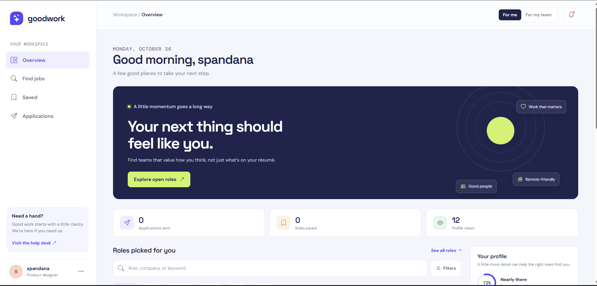
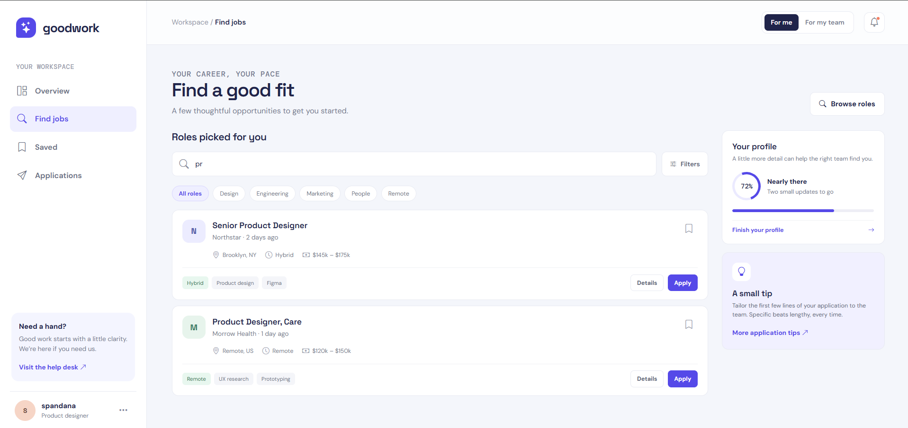
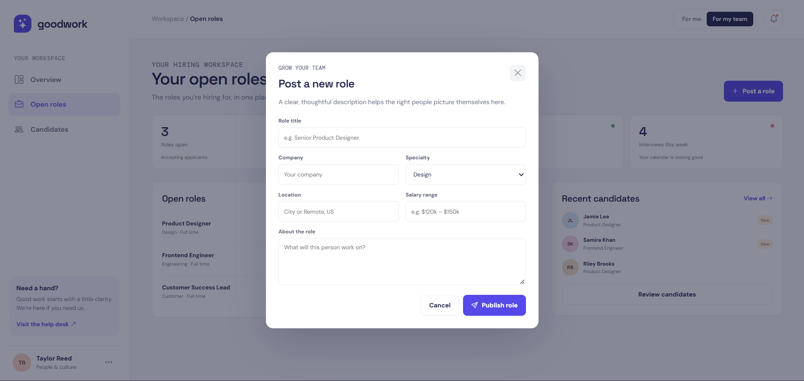

# Goodwork Job Portal

A polished, responsive frontend prototype for discovering jobs, managing applications, and reviewing candidates.

**Goodwork** provides two simulated dashboard experiences in a single-page interface:

- **Candidate view** for browsing and filtering roles, saving jobs, and submitting local application forms.
- **Employer view** for posting roles, reviewing sample candidates, updating candidate stages, and pausing or reopening listings.

This project is a frontend-only demonstration. Job listings, candidates, application data, and dashboard values are provided by the frontend code or stored in the browser. It does not include a backend, database, real authentication, email delivery, or API integration.

## Live Demo

- **GitHub Pages:** [https://marripatispandana.github.io/good-work--job-portal/]

## Features

### Candidate Experience

- Switch between the candidate and employer dashboard modes.
- Browse a predefined set of job listings.
- Search roles by title, company, location, category, or skill.
- Filter roles by specialty or by remote arrangement.
- View job details in an accessible modal.
- Save and remove roles from a saved-jobs collection.
- Submit application forms with a name, email address, and note.
- View submitted applications in a separate applications view.
- Edit the candidate display name and role specialty.

### Employer Experience

- View a hiring overview with open-role and candidate pipeline cards.
- Create a new role through a modal form.
- Add custom roles to the frontend job listing data.
- Pause or reopen existing role listings.
- Browse a sample candidate directory.
- Search and filter candidates by role.
- Open candidate profiles and mark candidates as shortlisted or not moving forward.

### Interface and Data Behavior

- Responsive desktop, tablet, and mobile layouts.
- Keyboard-friendly modal closing with the Escape key.
- Browser local storage persistence for saved roles, applications, profile details, custom roles, candidate stages, and role statuses.
- Toast notifications and empty-state messaging.
- HTML escaping for user-entered values rendered into interface templates.
- Reduced-motion support through a CSS media query.

## Technologies Used

- **HTML5** — semantic document structure, forms, and accessible landmarks
- **CSS3** — responsive layouts, custom properties, component styling, and media queries
- **Vanilla JavaScript** — dashboard rendering and browser-side interactions
- **Browser Local Storage** — persistence within the current browser
- **Google Fonts** — DM Sans, Space Grotesk, and DM Mono
- **Bootstrap Icons 1.11.3** — interface icons through a CDN

No frontend framework, build tool, backend, or database is used.

## Project Structure

```text
job connect/
├── index.html              # Complete UI, styles, sample data, and JavaScript
├── job connect.code-workspace
├── skills-lock.json        # VS Code skill configuration metadata
└── README.md               # Project documentation
```

The primary application is contained in `index.html`, so there is no separate build output to generate.

## Getting Started

### Prerequisites

You only need a modern web browser. To serve the project with a local development server, an optional tool such as Python or the VS Code Live Server extension is useful.

### Option 1: Open the HTML File

1. Clone or download the repository.
2. Open `index.html` directly in your browser.

### Option 2: Run with VS Code Live Server

1. Open the project folder in VS Code.
2. Install the **Live Server** extension if it is not already installed.
3. Right-click `index.html`.
4. Select **Open with Live Server**.
5. Open the local URL shown by Live Server, usually `http://127.0.0.1:5500/index.html`.

### Option 3: Run with Python

From the project root:

```bash
python -m http.server 5500
```

Then visit [http://localhost:5500](http://localhost:5500).

> Application state is stored in `localStorage` for the current browser and origin. Clearing browser site data resets the demo.

## Screenshots

> Replace the placeholders below with screenshots of the completed interface.

### Candidate Overview



### Job Search and Filters



### Employer Dashboard




## Future Improvements

The following enhancements would require additional implementation and are not currently included:

- Connect candidate and employer data to a backend API and database.
- Add real user registration, login, authorization, and protected routes.
- Add server-side job posting, editing, deletion, and applications.
- Support resume uploads and file validation.
- Add company profiles, saved searches, pagination, and advanced filtering.
- Implement notifications and email confirmation services.
- Persist data across devices with a real account system.
- Add automated tests for JavaScript behavior and responsive layouts.
- Improve profile and candidate data with complete user-created records.
- Add accessibility auditing and further screen-reader testing.

## License

No license file is currently included. Add a license before reusing or distributing the project publicly.

## Author

Created as a frontend job portal interface and portfolio project.
